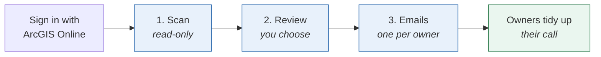
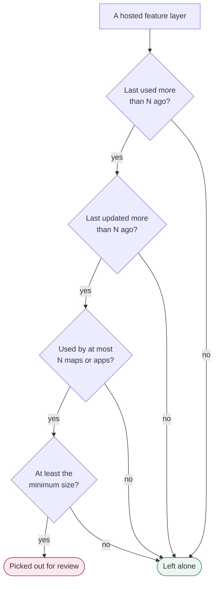
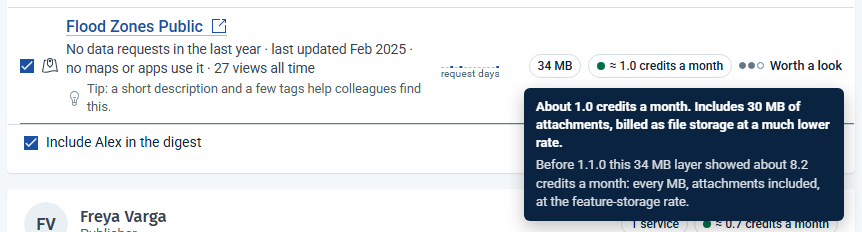
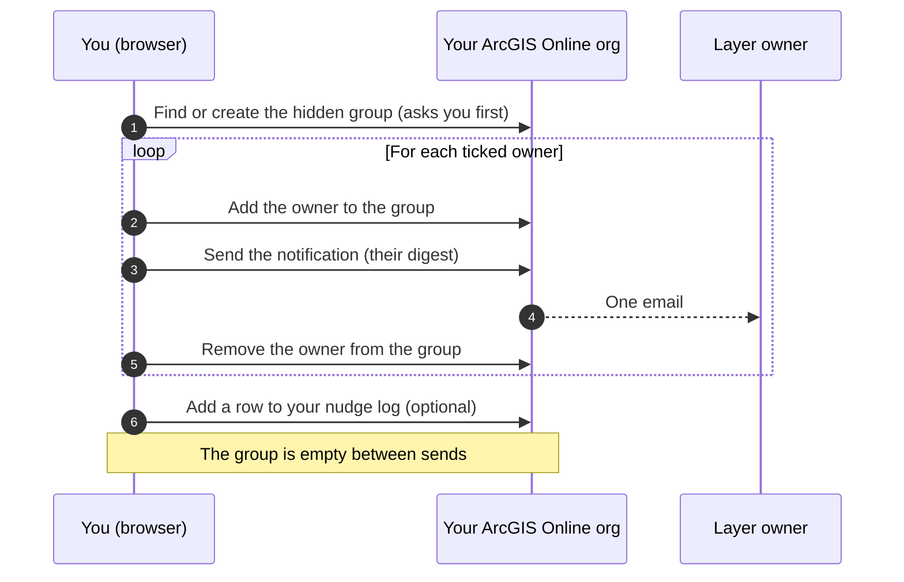
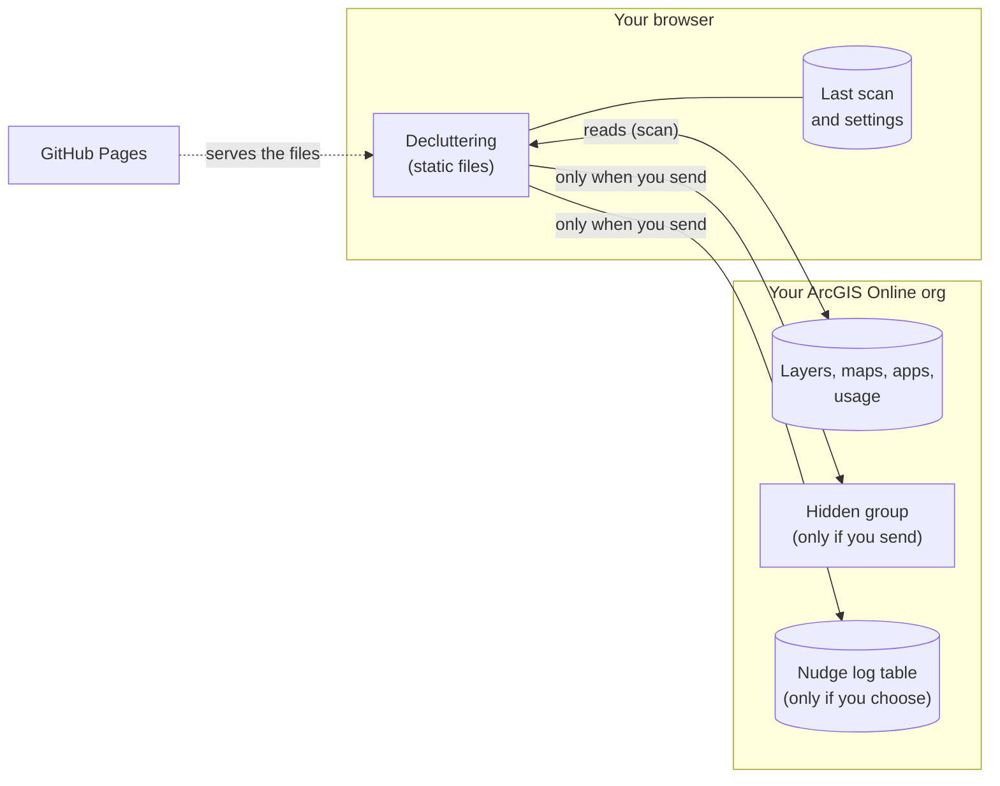

# Decluttering

**Tidy up your ArcGIS Online content, gently.**

https://simongis.github.io/decluttering-web/

Decluttering finds the hosted feature layers in your org that nobody seems to use, shows you why each one was picked out and what it costs in credits, and helps you send each owner **one friendly email** about them. Owners decide what happens to their own layers. The app **never deletes, moves or changes anyone's items**.

It runs entirely in your browser. There is no Decluttering server, and nothing goes anywhere except your own ArcGIS Online org.

> **Try it without signing in:** open the site and choose **Try the demo**. It plays a full scan of a made-up council's org, then lets you review the results and write the emails. Nothing is sent and nothing leaves your browser.

> **New, and built by one person.** Decluttering is version 1, so treat it as early days. Scanning and review only read your org. Emails go out only after you turn sending on and send yourself a test, and the app never deletes, moves or changes anyone's items. It's provided as is (see [Disclaimer](#disclaimer)); please [raise an issue](https://github.com/simongis/decluttering-web/issues) if something looks off. Ideas, feedback and collaborators are very welcome (see [Contributing and support](#contributing-and-support)).


---

## Why it exists

Hosted feature layers cost credits every month just by existing, and orgs collect hundreds of them: old projects, one-off survey copies, "v2" layers nobody went back to. Admins can see them but don't want to delete other people's work, and owners rarely look.

Decluttering sits in between. It does the slow part (working out which layers really are unused), then hands the decision back to the people who own them, politely and once.

## How it works



### 1. Scan: it only reads


The scan reads your org's hosted feature layers, their size, their usage, and every web map and app, to see which layers they use. Every dot is a layer, placed by how long ago it was last updated (across) and last used (up). The shaded box is the **stale zone**.

You can open the review as soon as the basics are in; maps and apps keep being checked in the background. A big org (several thousand layers) takes a while, and a stopped scan can be resumed where it left off.

### 2. Review: you see exactly why

A layer is picked out only when **all four** parts of the rule are true:



You can see and change every number. Starting points fill them in:

| Starting point | Last used | Last updated | Used by | Size |
|---|---|---|---|---|
| **Gentle** | more than 1 year ago | more than 1 year ago | no maps or apps | 20 MB or more |
| **Balanced** | more than 6 months ago | more than 6 months ago | at most 1 | 15 MB or more |
| **Strict** | more than 3 months ago | more than 3 months ago | at most 2 | 10 MB or more |
| **Suggested** | worked out for your org: the gentlest setting that picks out a manageable list | | | |

Each layer says why it's on the list, roughly what it costs in **credits a month**, and how quick a win it is (**Quick win**, **Worth a look** or **Low impact**):


**How credits are worked out.** ArcGIS Online bills a hosted feature layer's data as feature storage (2.4 credits per 10 MB a month), but any attachments on it (photos, PDFs and other files added to features) as file storage, which is far cheaper (1.2 credits per GB a month). A layer's size includes its attachments, so the app prices each part at its own rate. A layer full of photos still shows its full size and stays on the list if it is stale; only its credit figure is lower. Hover the credits to see how much is attachments:



The figures are estimates for the month. Organization › Status › Storage in ArcGIS Online shows what was actually billed.

**What "last used" means.** It is the newer of two dates ArcGIS Online keeps for a layer and its hosted views: when it was last opened (its item page, Map Viewer, or a map or app that uses it), and the last day its data was requested by anything, including scripts. Days when a crawler touched hundreds of layers at once are set aside. When the app can't be sure, it leans towards "used": a layer whose usage couldn't be fully read is **never** picked out.

It also points out **maps and apps that refer to a layer that is no longer in your org**, which is worth fixing whatever you decide about the rest:


### 3. Emails: one friendly digest per owner


Pick a tone (friendly, brief or formal), edit the template once, and preview exactly what each owner will receive: only their own ticked layers, with links to the items and the credits they'd free. **Send yourself a test first.** Nothing goes out until you press Send and confirm.

ArcGIS Online sends notifications to group members, so Decluttering uses **one hidden, invitation-only group** that only you can see. It asks before creating it, reuses it, and you can remove it any time:




Each owner is then **left alone for six months**: on the next visit they're flagged as recently nudged and are not ticked by default. "Since your nudges" later shows what happened: layers removed, handed over, updated or used again.

## Your data stays in your org



- **No Decluttering server and no third-party storage.** GitHub Pages only serves the app's files. Your scan results and settings stay in this browser, and you can clear them from the user menu.
- **Sign-in is ArcGIS Online OAuth 2.0 with PKCE.** The token stays in this browser tab, goes in request headers (never in a web address), and is revoked when you sign out.
- **Every request passes an allow-list before it is made.** The scan may only read; sending may only touch the app's own hidden group; the log may only add rows to its own table. See `SECURITY.md`.
- **The nudge log** (optional) is a hosted table in your own org. It records who was nudged, when, and which items, never the message text.


## Sending is switched on by each admin

Anyone can sign in and review. Sending is off until **you** turn it on for yourself, inside the app:

1. On the checklist after sign-in, **Sending in this org** › **Turn on sending**. The app sets up one small hidden group that only you can see. Nothing is sent until you choose.
2. **Send yourself a test first.** Sending to owners unlocks for the session only after your own test has gone through, so the email you check is the one that goes out. Each new session asks again.
3. Send. Each owner gets one email, at most once every six months (counting every admin's nudges in your org). A run sends to at most 40 owners, at most 100 a day, a couple of seconds apart, and stops at the first problem ArcGIS reports.

**Turn off sending** (on the same checklist row, or About › App data) removes your hidden group. Your nudge log stays, so owners you nudged keep resting.

## Who can use it

After you sign in, the app shows a short checklist of what your account can do here.

| You can | Needs |
|---|---|
| Review the whole org | an admin role that can view all items and members (`portal:admin:viewItems`, `portal:admin:viewUsers`) |
| See "last used" | access to the org's usage reports |
| Send nudges (after you turn sending on for yourself) | create groups and add members to them (`portal:user:createGroup`, `portal:admin:assignToGroups`) |
| Anyone else | review their own layers |

### If your organisation only allows approved apps

Some organisations only let members sign in to approved apps (ArcGIS Online › Organization › Settings › Security › Approved apps). If that is yours, an administrator needs to add Decluttering to that list first. We'll add exact steps once we've confirmed them in an organisation with the setting on; the About page has the same note. See [Esri's security settings page](https://doc.arcgis.com/en/arcgis-online/administer/configure-security.htm).

## Run your own copy

Requirements: Node 22.

```
npm ci
cp .env.example .env      # then fill in VITE_ARCGIS_CLIENT_ID
npm run dev               # http://localhost:5173
```

1. **Register the app in ArcGIS Online.** Content › New item › Developer credentials › OAuth 2.0 credentials. Add the redirect URLs `http://localhost:5173/` and your site's address (for example `https://<you>.github.io/decluttering-web/`). Put the client ID in `VITE_ARCGIS_CLIENT_ID`. It is public by design; there is no secret.
2. **Choose where sending can be turned on** with `VITE_SENDING`: empty or `off` (review-only), `list` (only the org ids in `VITE_WRITABLE_ORG_IDS`) or `opt-in` (any org; each admin turns it on for themselves).

Checks: `npm run typecheck && npm run lint && npm test && npm run e2e`.

### Deploy to GitHub Pages

`.github/workflows/deploy-pages.yml` checks (typecheck, lint, tests), builds and deploys on every push to `main`.

1. Settings › Pages › Source: **GitHub Actions**.
2. Settings › Secrets and variables › Actions › **Variables**:
   - `VITE_ARCGIS_CLIENT_ID` (required)

## Built with

[Calcite Design System](https://developers.arcgis.com/calcite-design-system/), [ArcGIS REST JS](https://developers.arcgis.com/arcgis-rest-js/), [Lit](https://lit.dev/), [D3](https://d3js.org/) and [Driver.js](https://driverjs.com/), with Vite and TypeScript. Third-party notices: `LICENSES.md`.

## Version

**1.2.0** (31 October 2026):
- **Spanish.** The app now comes in Español as well as English, contributed by Aitor Calero (@aitorcalero). It follows your ArcGIS Online language, and you can change it in the account menu. Owner emails stay in English for now. See `CONTRIBUTING.md` to add a language.
- **Content status filters.** Authoritative items are left out by default; deprecated items are included, and you can switch them off (issue #2).
- **Hover tips always on top,** in both looks.

**1.1.0** (31 October 2026):
- **Attachments are priced as file storage.** Layers with lots of photos or documents no longer look far more expensive than they are (see [How credits are worked out](#2-review-you-see-exactly-why)). No extra requests to your org; saved scans refresh their figures in the background on the next rescan.
- **JLP theme.** A switch at the top right, beside About, turns on an optional retro console look, with charts to match. Your choice is remembered in this browser; the switch turns it back off. Emails are not affected.

**1.0.0** (23 October 2026): scan and review any ArcGIS Online org you sign in to, and, once you turn sending on for yourself and send yourself a test, one friendly email per owner. One shared app for every organisation; nothing to register or install.

## Disclaimer

- Decluttering is an independent, open-source project. It is not an Esri or Esri Australia product, and it is not endorsed or supported by either.
- It is provided **"as is", without warranty of any kind**, and without liability for any loss or damage, as set out in the Apache License 2.0 (sections 7 and 8). You use it at your own risk.
- You are responsible for how you use it in your organisation: whose content you review, and any email you choose to send to colleagues. Check that it fits your organisation's policies first, and send yourself a test before anyone else gets an email.
- The app never deletes, unshares or changes anyone's items. What an owner does after a nudge is their decision.
- ArcGIS and Esri are trademarks of Esri. They are used here only to describe what the app works with.

## Contributing and support

Contributions and collaboration are welcome. If you're an ArcGIS Online admin, the most useful thing you can do is try it on your own org and say what worked, what didn't, and what you'd want next. Bug reports, ideas, wording fixes and pull requests are all welcome on this repository's **Issues** page. For anything bigger, open an issue first so we can talk it through. If you'd like to collaborate more closely, reach out on [LinkedIn](https://www.linkedin.com/in/simongis/). See `CONTRIBUTING.md` for how to set up, write copy, and add or improve a language.

Decluttering is offered as is, without formal support. For security issues, see `SECURITY.md`.

## Licence

Apache License 2.0. See `LICENSE`.
